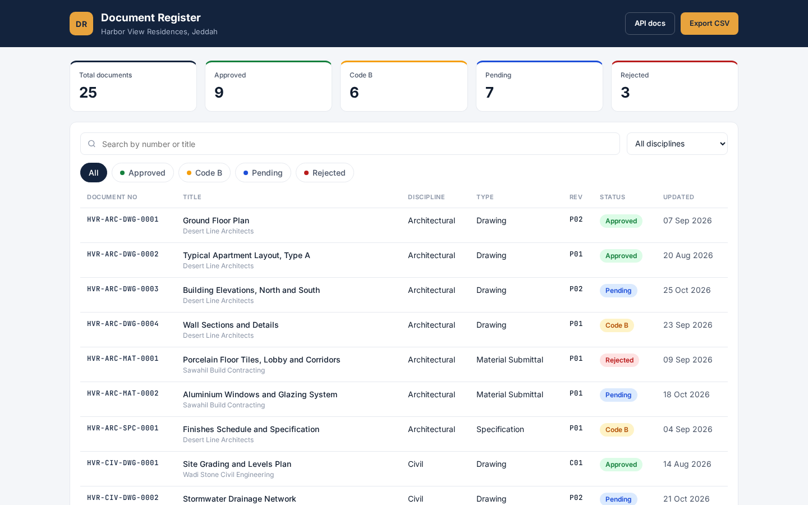
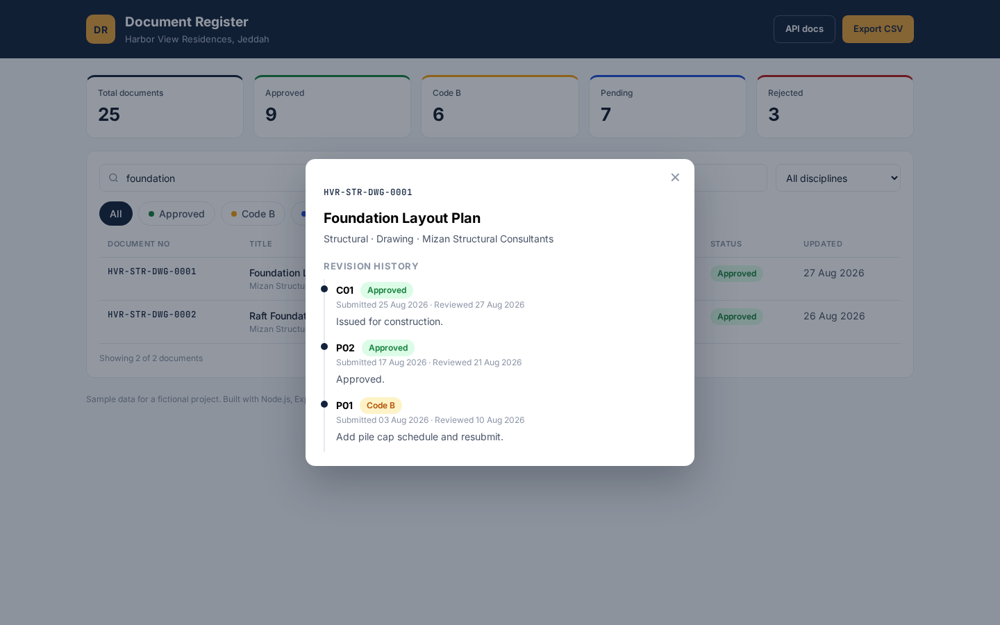
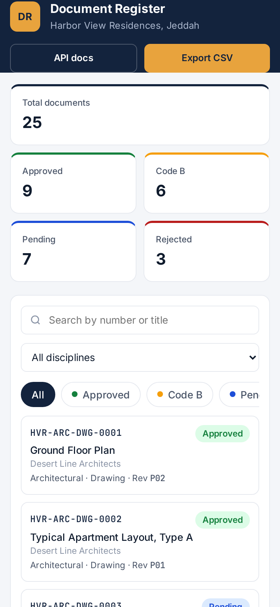
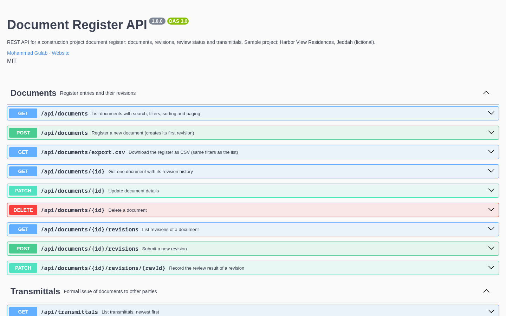

# Document Register API

A REST API and a clean register page for tracking construction project documents: drawings, method statements, material submittals and reports, with full revision history, review status and transmittals.

Built the way a Document Controller actually works: every submission gets a revision (P01, P02, C01), every review gets a status (Approved, Code B, Rejected), and every issue to another party goes on a numbered transmittal.



| Revision history | Mobile | API docs |
| --- | --- | --- |
|  |  |  |

## Features

- **Document register** with unique document numbers like `HVR-STR-DWG-0001`, discipline, type, originator, current revision and status
- **Search, filters, sorting and paging** on one endpoint: `q`, `status`, `discipline`, `type`, `sort`, `page`, `limit`
- **Revision workflow**: a new revision becomes the current one and puts the document back to Pending; reviewing the current revision updates the document status
- **Transmittals** with automatic numbers (`TR-0001`, `TR-0002` ...) that record exactly which revision of each document was sent, and why (For Approval, For Information, For Construction)
- **CSV export** of the register with the same filters, proper quoting and protection against spreadsheet formulas
- **Stats endpoint** with counts by status, discipline and type
- **Validation with zod**: clear `400` responses that list every bad field
- **Central error handling**: JSON errors for `400`, `404`, `409` and `500`, plus a JSON `404` for unknown routes
- **OpenAPI 3 spec** with interactive Swagger UI at `/docs`
- **Read only register page** at `/` with search, status chips, coloured status badges and a revision history popup
- **Seed script** with a sample project (Harbor View Residences, Jeddah, fictional): 25 documents and 4 transmittals
- **58 tests** with Jest and supertest, each running on a fresh in memory database

## Tech stack

| Part | Choice |
| --- | --- |
| Runtime | Node.js 18 or newer |
| Web framework | Express 4 |
| Database | SQLite through better-sqlite3 |
| Validation | zod |
| API docs | OpenAPI 3 and swagger-ui-express |
| Tests | Jest and supertest |
| Front end | Plain HTML, CSS and JavaScript (no framework) |

## Getting started

```bash
git clone https://github.com/mohammadgulab/doc-register-api.git
cd doc-register-api
npm install
cp .env.example .env
npm run seed
npm start
```

Then open:

- Register page: http://localhost:3000
- API docs: http://localhost:3000/docs
- Health check: http://localhost:3000/api/health

Other scripts:

```bash
npm run dev    # restart automatically when files change
npm test       # run the test suite
```

## Environment variables

| Name | Default | Description |
| --- | --- | --- |
| `PORT` | `3000` | Port the server listens on |
| `DB_FILE` | `./data/app.db` | Path of the SQLite database file, created on first run |
| `PROJECT_NAME` | `Harbor View Residences, Jeddah` | Project name shown on the register page and in `/api/health` |

## API endpoints

| Method | Path | Description |
| --- | --- | --- |
| GET | `/api/health` | Service and database health check |
| GET | `/api/documents` | List documents. Query: `q`, `status`, `discipline`, `type`, `sort`, `page`, `limit`. Returns `{ data, page, limit, total }` |
| GET | `/api/documents/export.csv` | Download the register as CSV, same filters as the list |
| GET | `/api/documents/:id` | One document with its revision history |
| POST | `/api/documents` | Register a new document, its first revision is created too |
| PATCH | `/api/documents/:id` | Update number, title, discipline, type or originator |
| DELETE | `/api/documents/:id` | Delete a document (refused with `409` if it is on a transmittal) |
| GET | `/api/documents/:id/revisions` | List revisions, oldest first |
| POST | `/api/documents/:id/revisions` | Submit a new revision, it becomes current and the document goes to Pending |
| PATCH | `/api/documents/:id/revisions/:revId` | Record a review: status and remarks |
| GET | `/api/transmittals` | List transmittals, newest first, with item counts |
| POST | `/api/transmittals` | Issue a transmittal, the number is assigned automatically |
| GET | `/api/transmittals/:id` | One transmittal with its documents and revisions |
| GET | `/api/stats` | Counts by status, discipline and type |
| GET | `/openapi.json` | The OpenAPI 3 spec |
| GET | `/docs` | Swagger UI |

Allowed values:

- **status**: Pending, Approved, Code B, Rejected
- **discipline**: Architectural, Structural, MEP, Civil
- **type**: Drawing, Method Statement, Material Submittal, Report, Specification
- **purpose** (transmittals): For Approval, For Information, For Construction
- **sort**: `doc_no`, `title`, `discipline`, `type`, `status`, `current_rev`, `created_at`, `updated_at`, add a leading `-` for descending, for example `-updated_at`

### Examples

Search for approved structural documents:

```bash
curl "http://localhost:3000/api/documents?discipline=Structural&status=Approved&sort=-updated_at"
```

Submit a new revision:

```bash
curl -X POST http://localhost:3000/api/documents/3/revisions \
  -H "Content-Type: application/json" \
  -d '{"rev": "P03", "remarks": "Riser openings added"}'
```

Record a review:

```bash
curl -X PATCH http://localhost:3000/api/documents/3/revisions/5 \
  -H "Content-Type: application/json" \
  -d '{"status": "Code B", "remarks": "Approved with comments, resubmit"}'
```

Issue a transmittal:

```bash
curl -X POST http://localhost:3000/api/transmittals \
  -H "Content-Type: application/json" \
  -d '{"to_party": "Mizan Structural Consultants", "subject": "Slab layout for review", "purpose": "For Approval", "items": [{"document_id": 3}]}'
```

A validation error looks like this:

```json
{
  "error": "Validation failed",
  "details": [
    { "field": "discipline", "message": "Must be one of: Architectural, Structural, MEP, Civil" },
    { "field": "title", "message": "Required" }
  ]
}
```

## Project structure

```
doc-register-api/
├── src/
│   ├── routes/
│   │   ├── documents.js      # documents, revisions and CSV export
│   │   ├── transmittals.js   # transmittals and their items
│   │   ├── stats.js          # counts by status, discipline and type
│   │   └── health.js         # health check
│   ├── app.js                # builds the Express app
│   ├── server.js             # starts the server
│   ├── db.js                 # SQLite connection and schema
│   ├── schemas.js            # zod validation schemas
│   ├── errors.js             # error classes and handlers
│   ├── openapi.js            # OpenAPI 3 spec
│   ├── csv.js                # CSV helpers
│   ├── constants.js          # allowed values
│   ├── util.js               # date helpers
│   └── seed.js               # sample project data
├── public/
│   ├── index.html            # register page
│   ├── app.js
│   └── style.css
├── tests/
│   ├── helpers.js
│   ├── documents.test.js
│   ├── revisions.test.js
│   ├── transmittals.test.js
│   └── app.test.js
├── docs/screenshots/
├── .env.example
├── package.json
└── LICENSE
```

## Database

| Table | Purpose |
| --- | --- |
| `documents` | One row per document number, with current revision and status |
| `revisions` | Every submission of a document, with review status, dates and remarks |
| `transmittals` | Numbered issues of documents to another party |
| `transmittal_items` | Which document revisions went on each transmittal |

## Tests

```bash
npm test
```

The suite has 58 tests across 4 files. Every test file builds the app around a fresh in memory SQLite database loaded with the seed data, so tests never touch your real data and can run in any order. They cover:

- list, search, filters, sorting and paging
- creating, updating and deleting documents, including duplicate numbers and blocked deletes
- the revision workflow and review rules
- transmittal numbering, default revisions, and line by line validation errors
- CSV headers, quoting and formula protection
- stats, Swagger docs, the register page and `404` handling

## License

MIT, see [LICENSE](LICENSE). Copyright (c) 2026 Mohammad Gulab.
